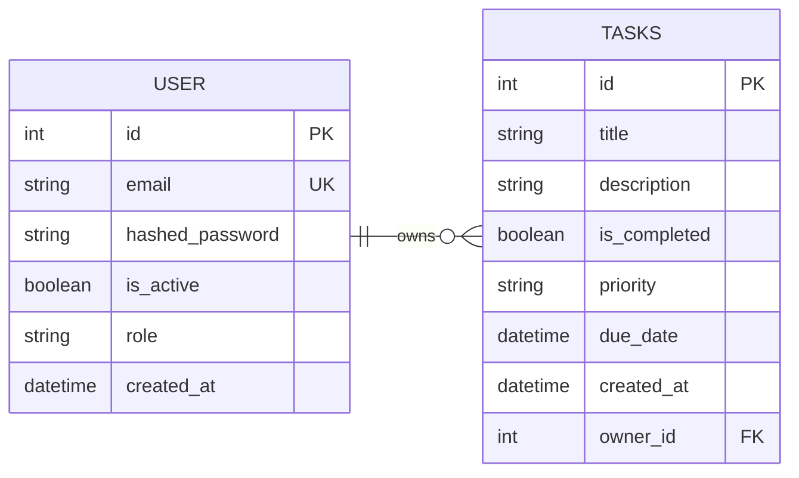

# Database Design Specification: [Task Manager]

A professional, detailed overview of the system's storage schema, data types, indexing strategy, and relationships.

## 1. Visual Entity-Relationship Diagram (ERD)
<!-- Use Mermaid syntax for native Markdown rendering, or link to your draw.io image asset -->

## 2. Table Schemas & Definitions

### A. `users` Table
Stores user credentials, access states, and security permissions.

| Column Name | Data Type | Constraints | Default | Description |
| :--- | :--- | :--- | :--- | :--- |
| `id` | SERIAL | Primary Key, Indexed | *None* | Unique auto-incrementing identifier. |
| `email` | VARCHAR(255) | Unique, Indexed, NOT NULL | *None* | User email used as the account identifier. |
| `hashed_password`| VARCHAR(255) | Nullable | NULL | Bcrypt hashed string. Nullable for Google Auth compatibility. |
| `is_active` | BOOLEAN | NOT NULL | `true` | Standard active state flag. |
| `role` | VARCHAR(50) | NOT NULL | `'member'` | Assigned RBAC tier (`admin`, `manager`, `member`). |
| `created_at` | TIMESTAMP | NOT NULL | `CURRENT_TIMESTAMP` | Account creation timestamp. |

### B. `tasks` Table
Stores individual assignments belonging to specific user accounts.

| Column Name | Data Type | Constraints | Default | Description |
| :--- | :--- | :--- | :--- | :--- |
| `id` | SERIAL | Primary Key, Indexed | *None* | Unique task record identifier. |
| `title` | VARCHAR(255) | NOT NULL, Indexed | *None* | Summary title of the task. |
| `description` | TEXT | Nullable | NULL | Optional expanded task details. |
| `is_completed` | BOOLEAN | NOT NULL | `false` | Tracks completion status. |
| `priority` | VARCHAR(20) | NOT NULL | `'medium'` | Execution priority (`low`, `medium`, `high`). |
| `due_date` | TIMESTAMP | Nullable | NULL | Optional assignment deadline. |
| `created_at` | TIMESTAMP | NOT NULL | `CURRENT_TIMESTAMP` | Auto-generated target timestamp. |
| `owner_id` | INTEGER | Foreign Key, NOT NULL | *None* | References `users.id` with `ON DELETE CASCADE`. |

## 3. Relational Architecture & Cardinality Rules

* **One-to-Many Connectivity:** A single row in the `users` table can be linked to zero, one, or many rows in the `tasks` table.
* **Cascading Deletions:** If a user account record is explicitly deleted from the system, the database automatically cascades the operation, purging all associated `tasks` records tied to that specific `owner_id`.

